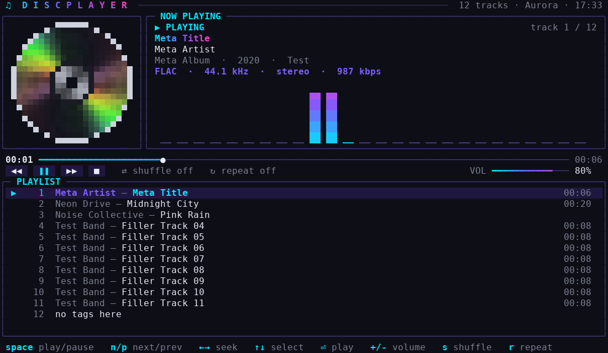

# discplayer

A neon-styled terminal music player for Linux, with a spinning optical disc and a live spectrum analyzer. Written in a single C++17 file with no build-time dependencies.



## Features

- **Spinning disc**: a smooth truecolor disc with moving iridescent glints. It spins up when you play and slows to a stop when you pause.
- **Live spectrum analyzer**: an FFT of the audio actually playing, drawn as gradient bars (needs `ffmpeg`).
- **Full now-playing info**: title, artist, album, year, genre, track number, codec, sample rate, channels and bitrate.
- **Playlist**: scrollable, with a selection cursor, track lengths and a scrollbar. Folders are scanned recursively and naturally sorted (`track2` comes before `track10`).
- **Transport controls**: play/pause, next/previous, stop, seek, shuffle, repeat (off / all / one), volume and mute.
- **Mouse support**: click the buttons, the progress bar or the volume bar, double-click a track to play it, and scroll with the wheel.
- **Live search**: press `/` to filter the playlist as you type.
- **6 color themes**: Aurora, Sunset, Ocean, Matrix, Ember and Mono.
- **Flicker-free rendering**: only changed rows are redrawn, and it falls back to 256 colors on terminals without truecolor.
- **Native tag reading**: ID3v2 (MP3), Vorbis comments (FLAC, Ogg, Opus) and FLAC durations, including Unicode text.

## Requirements

| Dependency | Needed for | Required? |
|---|---|---|
| `mpv` | decoding and audio output | **yes** |
| `ffmpeg` | live spectrum analyzer | optional |

A terminal with truecolor support gives the best look: kitty, alacritty, foot, wezterm, gnome-terminal, konsole and similar. The plain Linux text console (Ctrl+Alt+F3) does not render the block characters well.

Platform: **Linux x86-64**. WSL2 should work but is untested. There is no native Windows or macOS build.

## Install

### Ubuntu / Debian
```bash
sudo apt install mpv ffmpeg
```

### Arch Linux
```bash
sudo pacman -S mpv ffmpeg
```

### Get discplayer

Download the prebuilt static binary from the [Releases](../../releases) page. It runs on any x86-64 Linux distro.

```bash
chmod +x discplayer
./discplayer ~/Music
```

Optional system-wide install:
```bash
sudo install -Dm755 discplayer /usr/local/bin/discplayer
```

### Build from source
```bash
# Ubuntu/Debian: sudo apt install g++ libc6-dev
# Arch:          sudo pacman -S gcc
g++ -std=c++17 -O2 -static -o discplayer discplayer.cpp
```
Drop `-static` if you prefer a normal dynamically linked binary.

## Usage

```bash
discplayer [options] [FILE_OR_DIR ...]     # default: ~/Music
```

| Option | Description |
|---|---|
| `--no-viz` | disable the ffmpeg-based spectrum analyzer |
| `-h`, `--help` | show help |
| `-v`, `--version` | show version |

Supported formats include MP3, FLAC, Ogg, Opus, WAV, M4A/AAC, WMA, APE, AIFF, WavPack and MKA, plus anything else mpv can decode.

### Keys

| Key | Action |
|---|---|
| `Space` | play / pause |
| `n` / `p` | next / previous (`p` restarts the track if more than 3 s in) |
| `←` `→` (or `h` `l`) | seek ∓5 s |
| `[` `]` | seek ∓30 s |
| `↑` `↓` (or `j` `k`) | move selection |
| `PgUp` `PgDn`, `g` `G` | page / jump to top or bottom |
| `Enter` | play selected track |
| `c` | jump the selection to the playing track |
| `+` `-` | volume |
| `m` | mute |
| `s` | shuffle |
| `r` | repeat: off, all, one |
| `x` | stop |
| `/` | search (`Enter` keeps the filter, `Esc` clears it) |
| `t` | cycle theme |
| `q` | quit |

### Environment variables

| Variable | Description |
|---|---|
| `DISCPLAYER_MPV_ARGS` | extra flags passed to mpv, e.g. `--audio-device=alsa/hw:1` |

discplayer runs mpv with `--no-config`, so your own `mpv.conf` is ignored. Use the variable above to pass anything you need.

## How it works

discplayer is a small event loop on top of three pieces:

1. **mpv** runs as a child process and is controlled over its JSON IPC socket. discplayer observes properties such as `time-pos`, `pause` and `metadata` instead of polling.
2. **ffmpeg** (optional) decodes the current track to mono PCM at real-time speed. A built-in FFT turns that into log-spaced spectrum bars.
3. **A hand-written terminal layer** handles raw input, SGR mouse reporting, UTF-8 width handling and a row-diff renderer, so no curses library is needed.

## Troubleshooting

- **No sound**: run `mpv --audio-device=help` to list devices, then use `DISCPLAYER_MPV_ARGS="--audio-device=..." discplayer`.
- **"mpv not found"**: install mpv and make sure it is on your `PATH`. Snap and Flatpak builds may not be able to reach your music folder or the IPC socket, so prefer the distro package.
- **No spectrum**: install `ffmpeg`, or check that it is on your `PATH`.
- **Garbled or missing symbols**: use a UTF-8 locale and a font with box-drawing and block characters (most monospace fonts have them).
- **"Terminal too small"**: the minimum size is 72×22.

## Status and testing

discplayer was developed and tested on Ubuntu 24.04 in a pseudo-terminal, using a mock mpv that speaks the same JSON IPC protocol, with real ffmpeg for the spectrum. Playback, seeking, mouse input, search, auto-advance and exit cleanup were verified this way. Real-audio testing against a full mpv install is limited, so bug reports are welcome.

## License

MIT.
